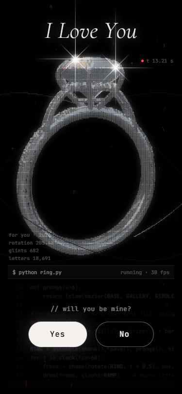
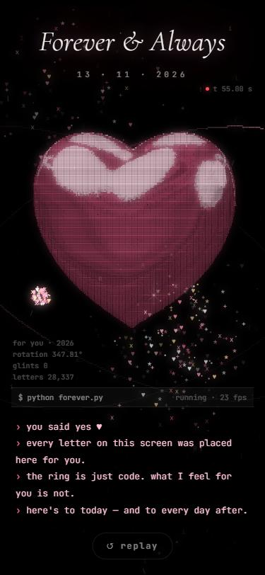
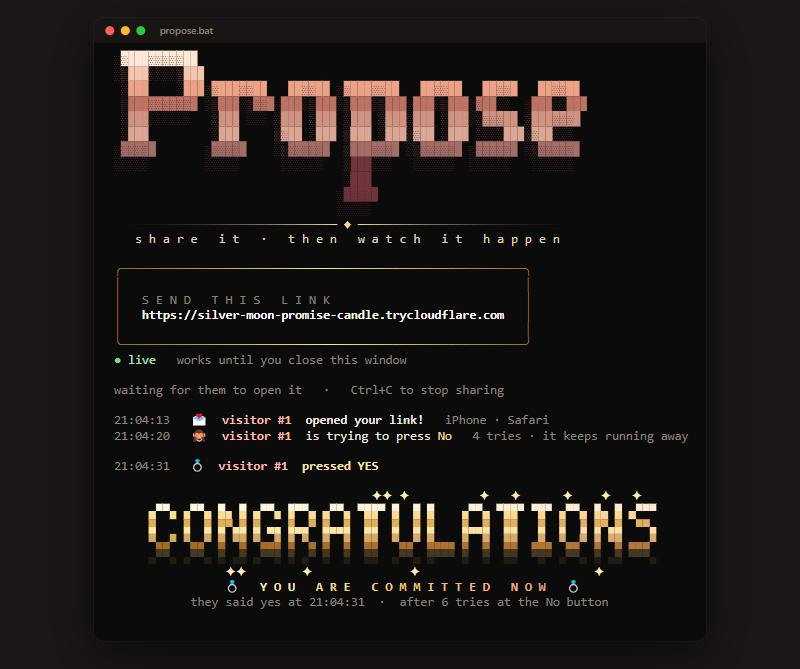

<div align="center">

# 💍 Propose

**A glowing diamond ring drawn from 10,000+ letters that says _I Love You_,**<br>
**with a _No_ button that refuses to be pressed.**<br>
Send it with one command, then watch them say yes, live in your terminal.

[](https://github.com/nadish-tech-boss/propose/actions/workflows/ci.yml)


[](LICENSE)

&nbsp;&nbsp;




</div>

---

## What happens

1. **You run one command.** It prints a private link like `https://silver-moon-promise-candle.trycloudflare.com`.
2. **They open it.** A platinum ring with a 57-facet diamond, a hidden halo and pavé
   shoulders draws itself out of glowing letters, then turns under studio lights.
3. **"I Love You" appears, with _Yes_ and _No_.** The _No_ button jumps away whenever a cursor
   or finger gets close. It can't be clicked, tapped or tabbed to.
4. **They press _Yes_.** The ring bursts into a glossy 3D heart, glyph fireworks go off,
   love notes type themselves out, and it ends on **Forever & Always** with today's date.
5. **Meanwhile, your terminal shows everything live:**
   ```
   21:04:13   💌  visitor #1  opened your link!   iPhone · Safari
   21:04:20   🙈  visitor #1  is trying to press No   4 tries · it keeps running away
   21:04:31   💍  visitor #1  pressed YES
                ✦ C O N G R A T U L A T I O N S ✦   (in shining metallic gold)
                💍   Y O U   A R E   C O M M I T T E D   N O W   💍
   ```

## Quick start

You only need **Python 3.8+**. Nothing else to install: the first run offers to download
[`cloudflared`](https://github.com/cloudflare/cloudflared) (Cloudflare's official, free tunnel tool) into `./bin`.

**Windows** (double-click `propose.bat`, or in cmd):

```bat
git clone https://github.com/nadish-tech-boss/propose.git
cd propose
propose.bat
```

**Linux**:

```bash
git clone https://github.com/nadish-tech-boss/propose.git
cd propose
chmod +x propose.sh
./propose.sh
```

Copy the link from the gold card and send it. The link works for as long as the window stays
open. **Ctrl+C** stops sharing, and every run gets a brand-new link.

> **Try it on yourself first:** `propose.bat --local` (or `./propose.sh --local`), then open
> <http://127.0.0.1:8787>. To test the real link, open it on your phone with Wi-Fi turned off.

## Options

| Option | What it does |
|---|---|
| `--local` | No public link; serve on this computer only (a dry run) |
| `--port 9000` | Use a different local port (default `8787`, or the next free one) |
| `-y`, `--yes` | Download `cloudflared` without asking |

## Make it yours

Open `index.html` and edit the `CONFIG` block at the top of the `<script>`:

```js
const CONFIG = {
  title: 'I Love You',
  question: '// will you be mine?',
  messages: [ 'you said yes ♥', /* the love notes typed after Yes */ ],
  finalTitle: 'Forever & Always',
  hints: [ '// nice try', /* teasing lines under the buttons */ ],
  sound: true,          // a soft chime when they press Yes
};
```

## How it works

```
 their phone ──https──▶ *.trycloudflare.com ──▶ cloudflared ──▶ propose.py (127.0.0.1) ──▶ your terminal
                     Cloudflare quick tunnel      on your PC        serves the page,
                                                                    prints the events
```

- **The page** (`index.html`) is a single self-contained file. The ring is a 3D point cloud of
  about 90,000 points: a tapered comfort-fit band, cathedral arches, six claw prongs, a hidden
  halo, pavé shoulders with milgrain, and a brilliant-cut center stone with standard
  proportions. Each frame it is projected, lit by a studio environment map (every diamond facet
  flashes on its own), and drawn as 10,000 to 20,000 tiny letters.
- **The tool** (`propose.py`) uses only the Python standard library. It serves the page on
  `127.0.0.1`, starts a free Cloudflare quick tunnel, and prints what the page reports.

## Privacy & safety

- The page reports only three things to **your** terminal: _opened_, _tried to press No (count)_
  and _pressed Yes_, tagged with a random ID for that browser tab.
- Your terminal shows the device and browser (worked out from the user-agent) and, if Cloudflare
  provides it, a two-letter country code. Nothing is stored or logged to disk.
- The server listens on `127.0.0.1` only and serves **only** `index.html`. Your other files,
  `bin/` and the tool itself are never reachable through the link.
- Visitor-supplied text is cleaned before it reaches your terminal, so it can't inject escape codes.
- The page loads two fonts from Google Fonts. Opened as a plain file it works fully offline,
  with fallback fonts and without the live reporting.

## Troubleshooting

| What you see | Fix |
|---|---|
| `Python 3 is needed` | Install from [python.org](https://www.python.org/downloads/) and tick **Add python.exe to PATH** |
| Emoji show as squares | Use **Windows Terminal**; the classic cmd window falls back to plain symbols automatically |
| No link appears | Some school or office networks block Cloudflare; try another network. Remove any leftover `~/.cloudflared/config.yml` |
| "couldn't confirm it from here yet" | New links can take a minute to spread. Test on your phone; it usually works |
| The link stopped working | The window closed, the PC slept, or the internet dropped. Run it again for a new link |
| Linux: `permission denied` | `chmod +x propose.sh`, or run `sh propose.sh` |
| Linux: `bad interpreter` / `^M` | The file got Windows line endings: `sed -i 's/\r$//' propose.sh` |

## Development

```bash
python -m unittest discover -s tests -v
```

The tests cover the web server (only the page is served, malformed events are rejected), the
open → No → Yes flow, terminal-injection safety, the banner fitting one 80-column line,
platform detection for `cloudflared`, and the launchers' line endings. CI runs them on
Windows and Linux.

## Credits

- [Cloudflare quick tunnels](https://developers.cloudflare.com/cloudflare-one/connections/connect-networks/do-more-with-tunnels/trycloudflare/) via `cloudflared`
- Fonts: [JetBrains Mono](https://www.jetbrains.com/lp/mono/) and [Cormorant Garamond](https://fonts.google.com/specimen/Cormorant+Garamond)

## License

[MIT](LICENSE). Go make someone very happy. 💍
